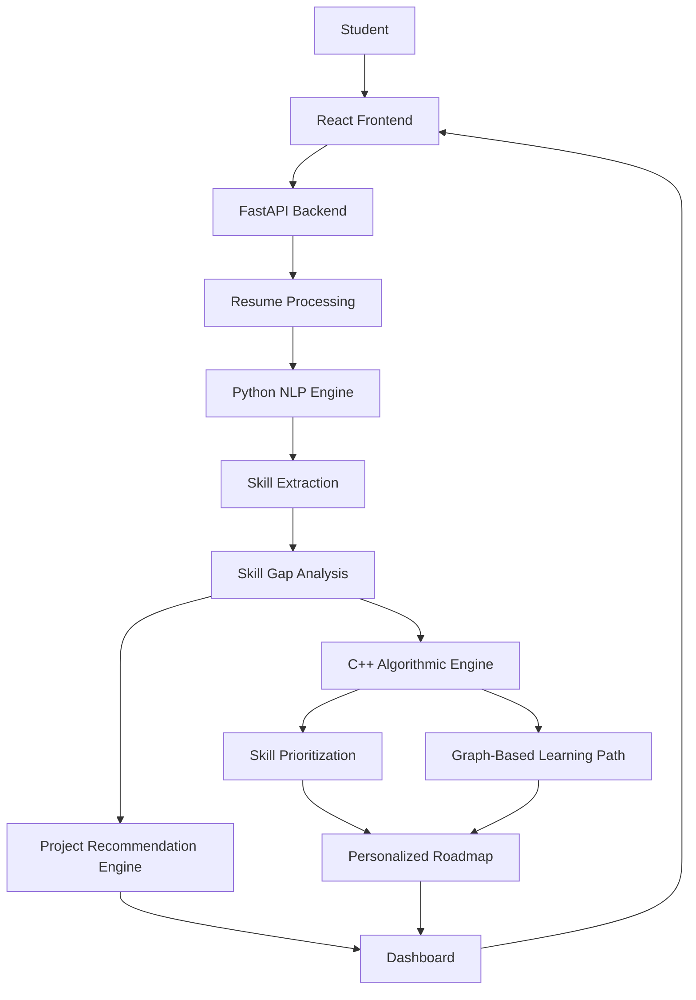
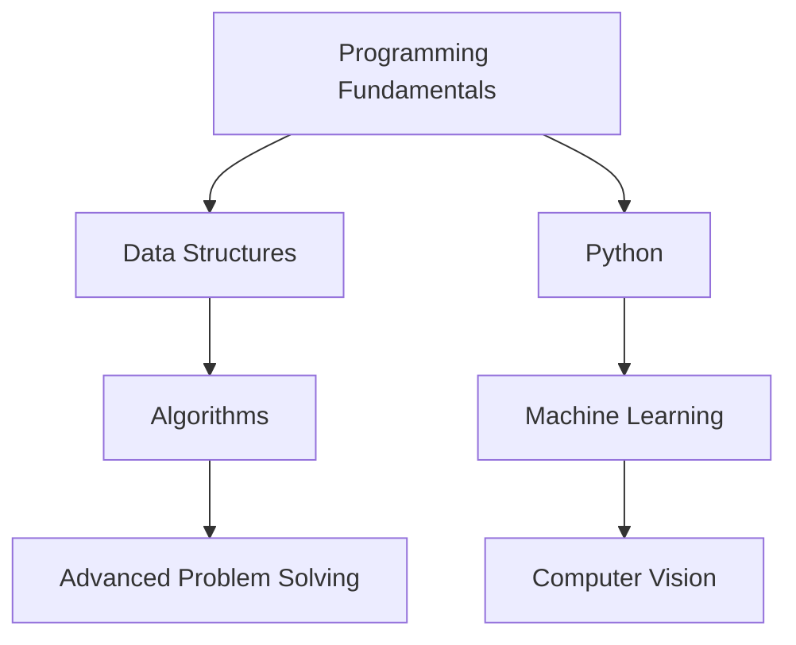
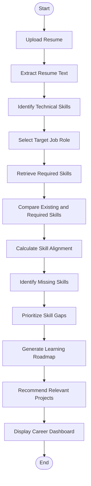

# SkillBridge
### Intelligent Skill Gap Analysis and Career Roadmap Generator

**Bridging the gap between academic knowledge and industry-ready skills.**

SkillBridge is an intelligent career guidance platform designed to help students identify skill gaps, understand industry requirements, and build personalized learning roadmaps for their desired career paths.

By combining **C++, Data Structures and Algorithms, Python, Natural Language Processing, and intelligent recommendation techniques**, SkillBridge aims to transform career preparation into a structured, data-driven process.

---

## Table of Contents

- [Overview](#overview)
- [Problem Statement](#problem-statement)
- [Our Solution](#our-solution)
- [Key Features](#key-features)
- [System Architecture](#system-architecture)
- [Technology Stack](#technology-stack)
- [Core Algorithms](#core-algorithms)
- [Project Workflow](#project-workflow)
- [Project Structure](#project-structure)
- [Getting Started](#getting-started)
- [Future Enhancements](#future-enhancements)
- [Technical Highlights](#technical-highlights)
- [Contributing](#contributing)
- [License](#license)

---

## Overview

Choosing a career path is only the first step. Understanding the skills required to reach that goal is often much harder.

Students frequently struggle to determine:
- Whether their current technical skills match industry expectations.
- Which skills they are missing for a particular job role.
- Which technologies they should prioritize learning.
- How to build a structured learning plan.
- Which practical projects can strengthen their profiles.

SkillBridge addresses these challenges through resume analysis, skill matching, gap detection, and personalized roadmap generation.

The platform is designed to help students make informed decisions about their technical growth and career preparation.

## Problem Statement

There is often a disconnect between what students learn academically and what employers expect from candidates.

Traditional career preparation can involve manually comparing resumes with job descriptions, searching for learning resources, and deciding which skills to prioritize.

This process can be time-consuming, confusing, and unstructured.

SkillBridge aims to make this process more systematic by translating a student's existing skill set into actionable recommendations.

## Our Solution

SkillBridge follows a structured approach:

1. **Analyze:** Extract technical skills from a student's resume.
2. **Compare:** Match existing skills against the requirements of a selected career role.
3. **Identify:** Detect missing skills and areas for improvement.
4. **Prioritize:** Rank skill gaps based on importance and relevance.
5. **Plan:** Generate a personalized learning roadmap.
6. **Recommend:** Suggest practical projects to strengthen missing skills.

The goal is not simply to provide a compatibility score, but to explain what a student can do next to become better prepared for their target role.

---

## Key Features

### 1. Smart Resume Analyzer
- Upload resumes in PDF or DOCX format.
- Extract and preprocess resume text.
- Identify relevant technical skills and keywords.
- Organize extracted skills into structured categories.

### 2. Intelligent Skill Gap Analysis
- Compare existing skills with target-role requirements.
- Identify matched and missing skills.
- Calculate a weighted role-alignment score.
- Highlight areas that require improvement.

### 3. Personalized Learning Roadmap
- Generate a structured learning path.
- Prioritize important missing skills.
- Consider prerequisite relationships between skills.
- Organize recommendations into a logical learning sequence.

### 4. Project Recommendation Engine
- Recommend practical projects based on skill gaps.
- Match projects with relevant technical skills.
- Provide difficulty levels and expected learning outcomes.

### 5. Career Readiness Dashboard
- Display skill coverage and role alignment.
- Visualize matched and missing skills.
- Present learning recommendations.
- Provide a clear overview of career preparation progress.

---

## System Architecture

The proposed architecture separates the frontend, backend, NLP processing, and algorithmic engine into independent modules.



*Architecture represents the planned system design and should be updated to reflect the final implementation.*

---

## Technology Stack

| Category | Technologies |
|---|---|
| Core Programming | C++, Python |
| Frontend | React.js, JavaScript, CSS |
| Backend | Python, FastAPI |
| NLP | Scikit-learn, TF-IDF |
| Similarity Analysis | Cosine Similarity |
| Algorithms | Dijkstra's Algorithm, Graph Traversal, Priority Queues |
| Database | PostgreSQL, SQLAlchemy |
| Visualization | Chart.js / Recharts |
| Version Control | Git, GitHub |

---

## Core Algorithms

A major focus of SkillBridge is the use of algorithmic problem-solving to generate meaningful learning recommendations.

### 1. TF-IDF (Term Frequency–Inverse Document Frequency)

Used to represent textual information from resumes and job descriptions.

TF-IDF helps identify terms that are important within a document while reducing the influence of overly common words.

### 2. Cosine Similarity

Used to compare textual representations of resumes and job descriptions.

It measures the similarity between two vectors:

\[
\text{Cosine Similarity}(A,B)=
\frac{A\cdot B}{\|A\|\|B\|}
\]

### 3. Graph-Based Skill Dependency System

Skills can have prerequisite relationships.

For example:



A graph-based representation helps organize skills into logical learning sequences.

### 4. Dijkstra's Shortest Path Algorithm

Dijkstra's algorithm can be used to identify a minimum-cost learning path through a weighted skill dependency graph.

This allows the roadmap engine to consider the estimated effort or cost associated with moving between skills.

### 5. Priority Queues

Priority queues can rank missing skills according to importance, relevance, and role requirements.

This helps students focus on high-impact skills first.

*The algorithms above describe the intended technical approach. Their implementation status should be verified against the actual source code.*

---

## Project Workflow



---

## Project Structure

The intended modular structure is:

```text
SkillBridge/
│
├── frontend/
│   ├── public/
│   └── src/
│       ├── components/
│       ├── pages/
│       ├── services/
│       ├── hooks/
│       └── assets/
│
├── backend/
│   ├── app/
│   │   ├── api/
│   │   ├── core/
│   │   ├── models/
│   │   ├── schemas/
│   │   ├── services/
│   │   └── main.py
│   ├── tests/
│   └── requirements.txt
│
├── cpp_engine/
│   ├── include/
│   ├── src/
│   └── CMakeLists.txt
│
├── data/
│   ├── skills.json
│   ├── job_roles.json
│   └── projects.json
│
├── docs/
│
├── .env.example
├── .gitignore
├── README.md
└── LICENSE
```

---

## Getting Started

### Prerequisites

Install the following tools:

- Git
- Python 3.x
- Node.js and npm
- C++ compiler supporting C++17 or later
- CMake
- PostgreSQL, if using the database-backed configuration

### 1. Clone the Repository

```bash
git clone https://github.com/ArshiyaTyagii/SkillBridge-Skill-Gap-Analysis-and-Career-Roadmap.git

cd SkillBridge-Skill-Gap-Analysis-and-Career-Roadmap
```

### 2. Backend Setup

```bash
cd backend

python -m venv venv
```

Activate the virtual environment:

**macOS / Linux**
```bash
source venv/bin/activate
```

**Windows**
```bash
venv\Scripts\activate
```

Install dependencies:

```bash
pip install -r requirements.txt
```

Start the backend:

```bash
uvicorn app.main:app --reload
```

### 3. Frontend Setup

Open a new terminal:

```bash
cd frontend

npm install

npm run dev
```

### 4. C++ Engine Setup

```bash
cd cpp_engine

mkdir build
cd build

cmake ..

cmake --build .
```

Run the compiled executable using the name and path generated by the build configuration.

### 5. Environment Configuration

Create a `.env` file using `.env.example` as a reference.

Configure database credentials and other required environment variables.

**Note:** These are intended setup instructions. Confirm the actual filenames, commands, and configuration before running them.

---

## Future Enhancements

- Integration with live job descriptions and industry skill requirements.
- More advanced NLP-based resume understanding.
- Support for additional career domains.
- Progress tracking and roadmap completion analytics.
- Personalized learning resource recommendations.
- Improved recommendation algorithms.
- User accounts and saved career roadmaps.
- More detailed career-readiness insights.

---

## Technical Highlights

SkillBridge is designed to demonstrate practical software engineering concepts through:

- Modular C++ development.
- Data Structures and Algorithms.
- Graph-based dependency modeling.
- Shortest-path algorithms.
- Priority-based optimization.
- Python-based NLP processing.
- REST API architecture.
- Database integration.
- Frontend-backend communication.
- Data visualization.

The project emphasizes the connection between algorithmic thinking and practical software development.

---

## Contributing

Contributions, suggestions, and improvements are welcome.

1. Fork the repository.
2. Create a feature branch.
3. Implement your changes.
4. Test your implementation.
5. Submit a pull request.

---

## Author

**Arshiya Tyagi**

Computer Engineering Student | Aspiring Software Engineer

GitHub: [@ArshiyaTyagii](https://github.com/ArshiyaTyagii)

---

## License

This project is intended for educational and development purposes. A license should be selected and added to the repository before redistribution.

---

**SkillBridge — Turning skill gaps into actionable career growth.**
