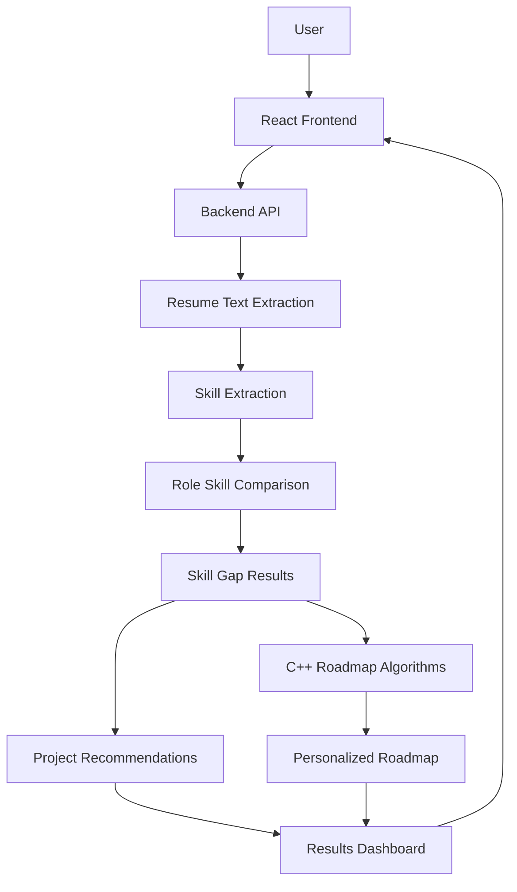

# SkillBridge Architecture

## Purpose

This document describes the intended high-level architecture of SkillBridge. Update it as implementation decisions are finalized.

## Proposed components

1. **Frontend:** React interface for resume submission, target-role selection, analysis results, and roadmap display.
2. **Backend API:** Python/FastAPI service responsible for request validation and coordinating application services.
3. **Resume processing:** Extracts text from supported resume formats and prepares it for skill extraction.
4. **NLP and matching:** Identifies candidate skills and compares them with curated role requirements.
5. **C++ algorithmic engine:** Provides algorithmic operations such as skill prioritization and graph-based learning-path calculations, where implemented.
6. **Data storage:** Stores role definitions, skills, prerequisites, project recommendations, and analysis records if database persistence is enabled.

## Proposed data flow

## Implementation note

This is a design document, not proof that every component is already implemented. Keep the diagram and descriptions synchronized with the actual source code.
